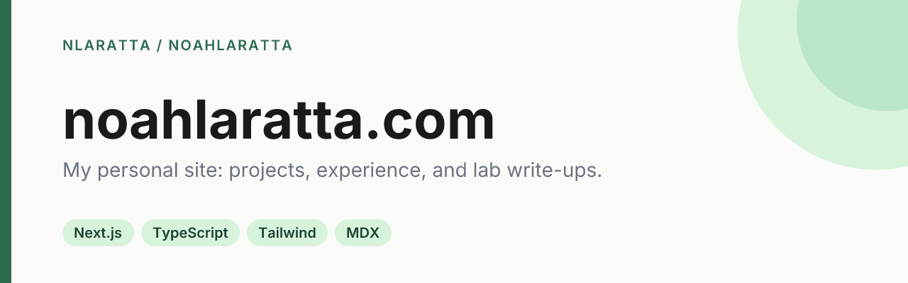

<p align="center">
  
</p>

<p align="center">
  <a href="https://github.com/nlaratta/noahlaratta/actions/workflows/deploy.yaml"></a>
  <a href="https://noahlaratta.com"></a>
</p>

The source for [noahlaratta.com](https://noahlaratta.com), my personal site. It covers my projects and experience, plus a lab section for longer write-ups on research and development workflow.

## Quick start

```bash
git clone https://github.com/nlaratta/noahlaratta.git
cd noahlaratta
npm ci
npm run dev        # http://localhost:3000
```

`npm run build` produces the static site in `out/`.

## How it works

- **Static export.** Next.js (Pages Router) with `output: 'export'`. There's no server or API routes, and every page is prerendered at build time.
- **Lab write-ups.** These are MDX files in `content/lab/`, rendered with `next-mdx-remote`, GFM, slugged headings and syntax highlighting. Interactive pieces live in `components/lab/`.
- **Build steps.** `scripts/generate-og.mjs` renders a branded Open Graph card for each page with satori and resvg before `next build`. `scripts/seo-postbuild.mjs` then writes the sitemap and feed into `out/`.
- **Deploys.** Every push to `main` builds the site in GitHub Actions and mirrors `out/` to the host over SFTP ([`deploy.yaml`](.github/workflows/deploy.yaml)). Pull requests build without deploying.

## Project structure

```
pages/          routes (index, about, projects, lab, lab/[slug])
components/     layout, navbar, MDX + lab components
content/lab/    lab articles (MDX with frontmatter)
lib/            project data, lab loader, SEO helpers
scripts/        OG image + sitemap/feed generation
public/         static assets, favicons, robots.txt, llms.txt
```

To update the content, edit project entries in `lib/projects.ts` and add articles as `content/lab/<slug>.mdx`.

## Tech stack

Next.js 15 · React 19 · TypeScript · Tailwind CSS · Framer Motion · MDX

## License

© Noah Laratta. The code is free to read and learn from. The site's content, photos and branding are not licensed for reuse.
